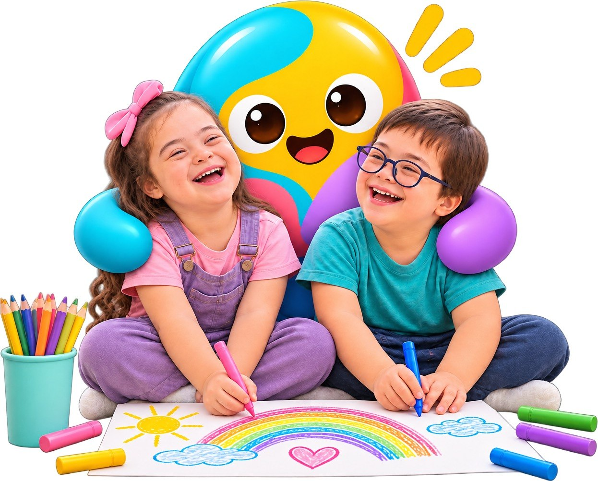
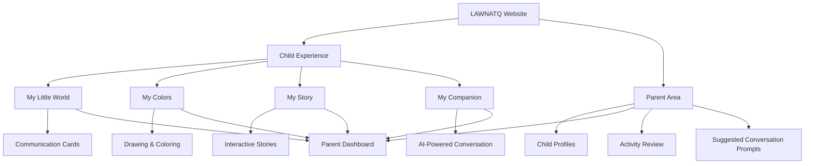
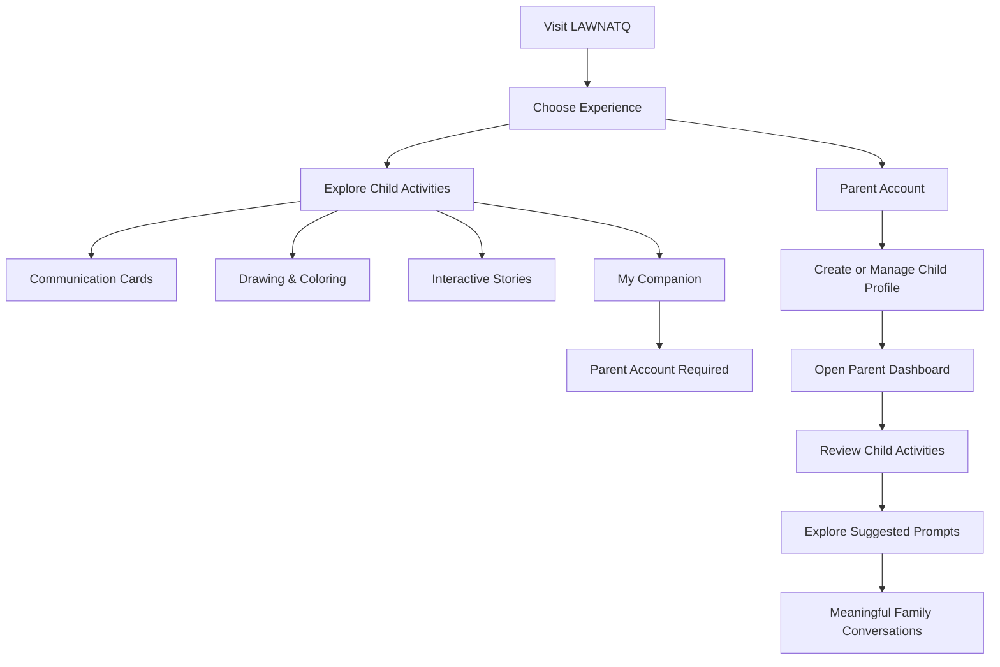

# LAWNATQ | لونُطق

### Your Colors Speak for You

**An Interactive Bilingual Platform for Children with Down Syndrome**

Designed with love, because every child deserves a story to tell.

[Explore the Website](#) · [Features](#key-features) · [Parents](#parent-experience) · [Accessibility](#accessibility--inclusion)

---

## About LAWNATQ

**LAWNATQ (لونُطق)** is a bilingual interactive website designed for children with Down syndrome aged **5–10 years**.

The platform provides different ways for children to express themselves through communication cards, drawing, coloring, and interactive storytelling.

Rather than relying on one way of communication, LAWNATQ offers children a welcoming space to explore, create, and express themselves at their own pace.

Parents can revisit their children's creations and use suggested questions to continue meaningful conversations together.

## Key Features

LAWNATQ brings together four interactive experiences:

| Experience | Description |
|---|---|
| **My Little World** | Communication cards for feelings, everyday needs, and common expressions. |
| **My Colors** | A creative drawing and coloring studio with free drawing and ready-to-color illustrations. |
| **My Story** | Personal storytelling and illustrated interactive stories where children's choices shape what happens next. |
| **My Companion** | An AI-powered chat companion that responds in simple language and encourages conversation. |

### 1. My Little World

Children can explore communication cards to express everyday needs and messages, such as:

- I need a break.
- Help me.
- I want to play.

Children can also explore cards they have created themselves.

### 2. My Colors

A creative space that encourages visual expression through:

- Free drawing.
- Ready-to-color illustrations.
- Wide outlines designed to make coloring easier.

### 3. My Story

A storytelling experience that includes personal story creation and a library of interactive stories.

Featured stories include:

- My First Day at School.
- The Little Turtle's Adventure.

Children make choices throughout the stories, helping shape what happens next.

### 4. My Companion

An AI-powered chat companion that uses simple language to interact with children.

Children can talk about their day or ask for an idea for their next drawing.

**Access note:** My Companion requires a parent account. Communication cards, stories, and drawing activities can be explored without one.

---

## Platform Architecture

The following diagram illustrates the main experience areas and how they connect to the parent experience.

## User Journey

The platform provides separate but connected experiences for children and parents.

## Parent Experience

The parent area is designed to help families stay connected with their children's activities.

Parents can:

- Create and manage separate profiles for their children.
- Customize accessibility preferences for each child.
- Review drawings, stories, and communication cards.
- Explore activity insights.
- Access suggested conversation prompts.

The parent dashboard brings children's creative activities together in one place, helping parents revisit and discuss what their children have explored and created.

## Accessibility & Inclusion

Accessibility is an essential part of the LAWNATQ experience.

The website includes:

- **Bilingual Support:** Arabic and English language options.
- **Reading Direction:** Layouts adapt to each language's reading direction.
- **Large Buttons:** Easy-to-use interactive controls.
- **Simplified Navigation:** Fewer choices per screen.
- **Adjustable Text Size:** Options to adapt text visibility.
- **Reduced Motion:** A setting to limit interface movement.

These features aim to make the experience more accessible, comfortable, and adaptable to individual needs.

## Responsible Use of AI

LAWNATQ uses AI in its companion feature to support simple conversational interaction.

The platform is designed to encourage expression and family communication. It does **not**:

- Diagnose medical or developmental conditions.
- Infer a child's feelings from drawings or colors.
- Replace professional assessment or treatment.

Families with health or developmental concerns should consult a qualified professional.

## Trial & Subscriptions

LAWNATQ lists the following subscription options:

| Plan | Price |
|---|---:|
| Free Trial | 7 Days |
| Monthly | SAR 19.99 |
| Annual | SAR 199 |

The listed trial provides access to communication cards, My Colors, stories, and My Companion.

---

## Project Highlights

- Designed specifically for children with Down syndrome aged 5–10.
- Combines communication, creativity, and interactive storytelling.
- Provides separate experiences for children and parents.
- Supports Arabic and English.
- Encourages meaningful family conversations.
- Prioritizes accessibility and responsible AI use.

## Our Vision

We believe every child has a unique way of expressing themselves.

LAWNATQ aims to create a welcoming digital space where children can communicate, create, and share their stories in their own way.

### LAWNATQ | لونُطق

**Your Colors Speak for You.**

© 2026 LAWNATQ. Designed with love, because every child deserves a story to tell.

