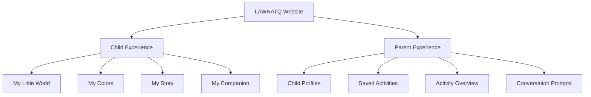
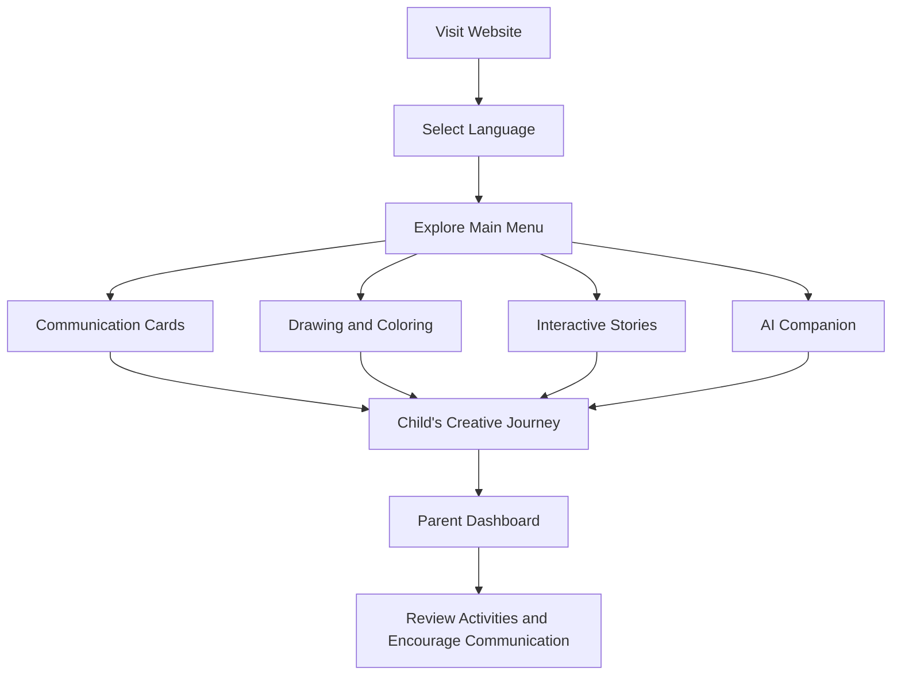

 

# LAWNATQ | لونُطق

### Your Colors Speak for You
**لونك ينطق عنك**

**Designed & Developed by**

**Jawaher Alhoqish | Maryam Alnaim**

---

## About the Project

LAWNATQ (لونُطق) is an interactive bilingual website designed to support children with Down syndrome, aged **5–10**, in expressing themselves, communicating their needs, and exploring their creativity.

The website provides an accessible digital environment through visual communication cards, drawing activities, interactive stories, and a conversational AI companion. It also gives parents a dedicated space to revisit their children's activities and encourage meaningful conversations.

## The Challenge

Some children with Down syndrome may experience difficulties expressing their thoughts, needs, and ideas verbally. This can make everyday communication challenging for both children and their parents.

LAWNATQ aims to make expression more accessible through simple, visual, and interactive experiences.

## Our Solution

LAWNATQ brings together different ways of expression in one supportive website, allowing children to communicate, create, and explore at their own pace.

## Main Features

| Feature | Description |
|---|---|
| **My Little World** | Visual communication cards that help children express their needs and everyday thoughts, with the ability to create personal cards. |
| **My Colors** | A creative space for free drawing, coloring, and exploring illustrations. |
| **My Story** | Personal story creation and an interactive illustrated story library. |
| **My Companion** | A conversational AI companion that encourages simple, accessible conversations and creative exploration. |
| **Parent Dashboard** | A dedicated area for parents to manage child profiles and revisit saved activities and creations. |

## Website Structure

## User Journey

## Accessibility & Inclusivity

LAWNATQ is designed to provide a clear and accessible experience through:

| Accessibility Feature | Purpose |
|---|---|
| Arabic & English | Supports both languages. |
| RTL & LTR Layouts | Provides appropriate layouts for each language. |
| Large Buttons | Makes navigation easier. |
| Adjustable Text Size | Supports different reading needs. |
| Reduced Motion | Offers a more comfortable browsing experience. |
| Simple Navigation | Keeps interactions clear and manageable. |

## Responsible Use of AI

The AI companion is designed to support conversation and creative exploration using simple, child-friendly language.

LAWNATQ is not a diagnostic or medical tool. It focuses on encouraging communication and providing parents with opportunities to engage with their children's activities.

## Subscription Plans

| Plan | Price |
|---|---:|
| Free Trial | 7 Days |
| Monthly | SAR 19.99 |
| Annual | SAR 199 |

**لأن لكل طفل لونًا وصوتًا يستحق أن يُسمع**

*Because every child has a color and a voice that deserves to be heard.*

### LAWNATQ | لونُطق

